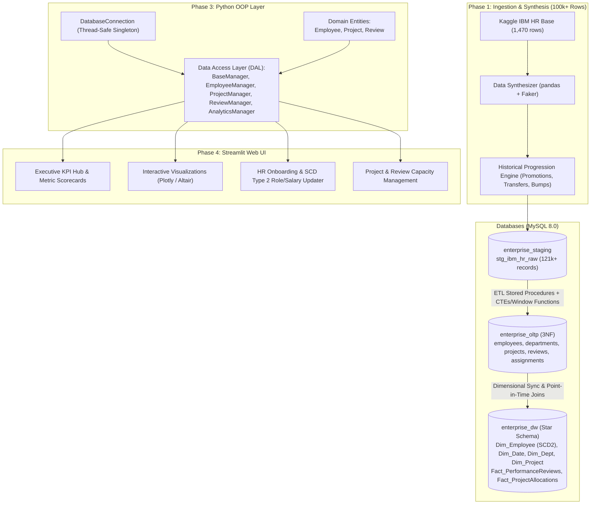

# Enterprise Employee Analytics & Data Warehouse System

[](https://www.python.org/)
[](https://www.mysql.com/)
[](https://streamlit.io/)
[]()

An enterprise-grade, end-to-end data platform migrating legacy human resource records into a centralized Data Warehouse with **Slowly Changing Dimensions (SCD Type 2)**, an **Object-Oriented (OOP)** Data Access Layer, and an interactive **Streamlit** operational and executive analytics dashboard.

---

## 📑 Table of Contents
- [Executive Overview](#executive-overview)
- [System Architecture](#system-architecture)
- [Key Features by Phase](#key-features-by-phase)
  - [Phase 1: Architecture, Modeling & 100K+ Data Ingestion](#phase-1-architecture-modeling--100k-data-ingestion)
  - [Phase 2: Advanced SQL & ETL Pipelines](#phase-2-advanced-sql--etl-pipelines)
  - [Phase 3: Object-Oriented Backend (OOP)](#phase-3-object-oriented-backend-oop)
  - [Phase 4: Streamlit UI & Interactive Dashboards](#phase-4-streamlit-ui--interactive-dashboards)
  - [Phase 5: Version Control & Cloud Deployment](#phase-5-version-control--cloud-deployment)
- [Database Schema Designs](#database-schema-designs)
- [Advanced SQL Showcase (CTEs & Window Functions)](#advanced-sql-showcase-ctes--window-functions)
- [Installation & Local Setup](#installation--local-setup)
- [Running the Application](#running-the-application)
- [Test Suite & Quality Assurance](#test-suite--quality-assurance)
- [Streamlit Community Cloud Deployment](#streamlit-community-cloud-deployment)
- [Project Directory Structure](#project-directory-structure)

---

## 🎯 Executive Overview
Modern enterprises require operational responsiveness (OLTP) paired with historical point-in-time analytical depth (OLAP). This system addresses:
1. **Accurate Historical Tracking**: Captures employee transfers, promotions, and compensation changes over time via **SCD Type 2** without overwriting historical baselines.
2. **High Scale**: Scaled from 1,470 Kaggle IBM HR records to **100,000+ distinct employees** and **121,000+ versioned records**.
3. **Enterprise Architecture**: Segregates concerns into Staging, 3NF Relational OLTP, and Star Schema OLAP, mediated by an OOP Data Access Layer (DAL) and Thread-Safe Singleton Connection Pool.
4. **Rich Visual Analytics**: Executive KPI scorecards, department talent leaderboards (`DENSE_RANK`), YoY trajectories (`LAG`), attrition risk models (`NTILE`), and workload bottleneck analysis.

---

## 🏛️ System Architecture



---

## 🚀 Key Features by Phase

### Phase 1: Architecture, Modeling & 100K+ Data Ingestion
- **Kaggle IBM HR Ingestion**: Bootstraps the authentic IBM HR Analytics dataset (`WA_Fn-UseC_-HR-Employee-Attrition.csv`, 1,470 rows).
- **Volume Scaling**: Synthesizes 100,000 distinct employees and over 121,000 historical records using `pandas`, `numpy`, and `Faker`.
- **Engineered SCD Type 2 Data**: Generates realistic career trajectories (past department transfers, promotions, salary increments) with `EffectiveStartDate`, `EffectiveEndDate`, and `IsCurrent` flags.
- **Single Flat Staging Table**: Preserves all 35 Kaggle raw attributes inside `enterprise_staging.stg_ibm_hr_raw`.
- **Editable Diagrams**: Complete Draw.io / Lucidchart files for both OLTP 3NF and OLAP Star Schema in `diagrams/`.

### Phase 2: Advanced SQL & ETL Pipelines
- **Normalized OLTP (3NF)**: Structured tables (`departments`, `employees`, `projects`, `performance_reviews`, `project_assignments`) with foreign keys, constraints, and operational indexes.
- **Star Schema Data Warehouse**: Surrogate keys (`_sk`) across all dimensions; `Dim_Employee` enabled with SCD Type 2 temporal versioning; `Dim_Date` spanning 15 years (2015–2030).
- **ETL Stored Procedures**:
  - `sp_populate_dim_date`: Generates comprehensive date dimension records.
  - `sp_etl_staging_to_oltp`: Extracts, deduplicates, and normalizes raw staging data into 3NF OLTP tables using **CTEs** and **`ROW_NUMBER()`**.
  - `sp_etl_load_dimensions`: Synchronizes dimensions and loads versioned employees.
  - `sp_update_employee_scd2`: Production-grade SCD2 procedure expiring old versions and inserting new active records upon role/salary updates.
  - `sp_load_fact_performance_reviews`: Point-in-time joins matching review dates to the valid temporal window.

### Phase 3: Object-Oriented Backend (OOP)
- **Singleton Connection Pool (`src/db_manager.py`)**: Thread-safe `DatabaseConnection` using double-checked locking with connection health checks and automatic rollback.
- **Domain Entities (`src/entities/`)**:
  - `Employee`: Full encapsulation, salary progression tracking, property getters/setters, validation.
  - `Project`: Status transitions, budget utilization, and role allocation constraints.
  - `Review`: Weighted rating scoring and satisfaction-to-attrition risk diagnosis.
- **Data Access Layer (`src/dal/`)**:
  - `BaseManager`: Reusable transaction boundaries, parameter binding, and logging.
  - `EmployeeManager`: CRUD operations and SCD Type 2 update trigger.
  - `ProjectManager`: Project lifecycle and workload allocation checks ($\le 100\%$).
  - `ReviewManager`: Multi-cycle review submissions.
  - `AnalyticsManager`: Executes advanced SQL queries and returns analytical DataFrames.

### Phase 4: Streamlit UI & Interactive Dashboards
- **Executive KPI Dashboard**: Headcount, active projects, average compensation, rating distributions, and attrition rate metrics.
- **Analytics Hub (Powered by Advanced SQL)**:
  - *Query 1 (`DENSE_RANK`)*: Top-performing employees ranked within each department and cycle.
  - *Query 2 (`LAG`)*: Year-over-year rating delta and salary increment trajectory.
  - *Query 3 (`LEAD`)*: SCD Type 2 employee promotion and salary hike audit trail.
  - *Query 4 (`NTILE(4)`)*: Salary quartile segmentation vs. attrition risk tier heatmap.
  - *Query 5 (Workload CTEs)*: Project bottleneck and capacity over-allocation tracker.
- **HR Operations & Data Entry**:
  - New employee onboarding form with auto-generated employee numbers.
  - Promotion / Department Transfer form that triggers the SCD Type 2 database procedure live.
  - Project registration and capacity allocation forms.
- **Database Administrator View**: Schema inspector, live table count audits, and manual ETL sync triggers.

### Phase 5: Version Control & Cloud Deployment
- **Git Branching Strategy**: Feature branches (`feature/database-design`, `feature/advanced-sql-etl`, `feature/python-oop-backend`, `feature/phase-4-streamlit`) merged to `main` via pull requests.
- **Cloud-Ready**: Prepared for deployment on Streamlit Community Cloud with database connection fallbacks and environment variable configuration.

---

## 📊 Database Schema Designs

### 1. OLTP Relational Model (3NF)
Normalized database optimizing transactional consistency and operational read/writes:
- **`departments`**: `(department_id [PK], department_name [UK], cost_center_code, location)`
- **`employees`**: `(employee_id [PK], employee_number [UK], first_name, last_name, email [UK], gender, age, department_id [FK], job_role, job_level, monthly_income, attrition, hire_date)`
- **`projects`**: `(project_id [PK], project_code [UK], project_name, department_id [FK], priority, status, start_date, budget)`
- **`project_assignments`**: `(assignment_id [PK], employee_id [FK], project_id [FK], assigned_role, allocation_pct, assigned_date)`
- **`performance_reviews`**: `(review_id [PK], employee_id [FK], review_date, review_cycle, performance_rating, work_life_balance, job_satisfaction, training_times_last_year)`

### 2. OLAP Star Schema (Dimensional Model with SCD Type 2)
Dimensional warehouse optimizing complex analytical aggregations:
- **`Dim_Employee` (SCD Type 2)**:
  - `employee_sk` [Surrogate Key, PK]
  - `employee_id` [Natural Key from OLTP]
  - `department_name`, `job_role`, `job_level`, `monthly_income`, `attrition` [Tracked Attributes]
  - `effective_start_date`, `effective_end_date` [Validity Interval]
  - `is_current` [1 = Active, 0 = Historical]
  - `version` [Monotonically increasing version counter]
- **`Dim_Department`**: `(department_sk [PK], department_id [NK], department_name, cost_center_code, location)`
- **`Dim_Project`**: `(project_sk [PK], project_id [NK], project_code, project_name, priority, status, budget)`
- **`Dim_Date`**: `(date_key [PK: YYYYMMDD], full_date, day_of_month, day_name, month_num, month_name, quarter_name, year_num, is_weekend)`
- **`Fact_PerformanceReviews`**: `(fact_id [PK], review_id, employee_sk [FK], department_sk [FK], review_date_key [FK], performance_rating, work_life_balance, job_satisfaction, monthly_income)`
- **`Fact_ProjectAllocations`**: `(allocation_fact_id [PK], assignment_id, employee_sk [FK], project_sk [FK], assigned_date_key [FK], allocation_pct, assigned_role)`

---

## ⚡ Advanced SQL Showcase (CTEs & Window Functions)

### 1. Department Top Talent Ranking via `DENSE_RANK()`
```sql
WITH RankedDepartmentTalent AS (
    SELECT 
        e.employee_sk, e.full_name, d.department_name, e.job_role,
        f.performance_rating, f.job_satisfaction, f.monthly_income, dt.year_num,
        DENSE_RANK() OVER (
            PARTITION BY d.department_name, dt.year_num 
            ORDER BY f.performance_rating DESC, f.job_satisfaction DESC, f.monthly_income DESC
        ) AS dept_rank
    FROM enterprise_dw.Fact_PerformanceReviews f
    JOIN enterprise_dw.Dim_Employee e ON f.employee_sk = e.employee_sk
    JOIN enterprise_dw.Dim_Department d ON f.department_sk = d.department_sk
    JOIN enterprise_dw.Dim_Date dt ON f.review_date_key = dt.date_key
)
SELECT * FROM RankedDepartmentTalent WHERE dept_rank <= 5;
```

### 2. Year-Over-Year Performance & Salary Trajectory via `LAG()`
```sql
WITH AnnualEmployeePerformance AS (
    SELECT 
        e.employee_id, e.full_name, d.department_name, dt.year_num,
        AVG(f.performance_rating) AS avg_annual_rating,
        MAX(f.monthly_income) AS annual_salary
    FROM enterprise_dw.Fact_PerformanceReviews f
    JOIN enterprise_dw.Dim_Employee e ON f.employee_sk = e.employee_sk
    JOIN enterprise_dw.Dim_Department d ON f.department_sk = d.department_sk
    JOIN enterprise_dw.Dim_Date dt ON f.review_date_key = dt.date_key
    GROUP BY e.employee_id, e.full_name, d.department_name, dt.year_num
)
SELECT 
    employee_id, full_name, department_name, year_num,
    ROUND(avg_annual_rating, 2) AS rating,
    ROUND(LAG(avg_annual_rating, 1) OVER (PARTITION BY employee_id ORDER BY year_num), 2) AS prev_rating,
    ROUND(avg_annual_rating - LAG(avg_annual_rating, 1) OVER (PARTITION BY employee_id ORDER BY year_num), 2) AS yoy_delta,
    annual_salary,
    LAG(annual_salary, 1) OVER (PARTITION BY employee_id ORDER BY year_num) AS prev_salary
FROM AnnualEmployeePerformance;
```

---

## 🛠️ Installation & Local Setup

### Prerequisites
- Python 3.10+
- MySQL Server 8.0+ & MySQL Workbench
- Git

### 1. Clone the Repository
```powershell
git clone https://github.com/AkshayDhuke/enterprise-employee-analytics.git
cd enterprise-employee-analytics
```

### 2. Install Python Dependencies
```powershell
pip install -r requirements.txt
```

### 3. Configure Database Credentials
Create a `.env` file in the project root:
```env
DB_USER=root
DB_PASSWORD=your_mysql_password
DB_HOST=127.0.0.1
DB_PORT=3306
```

### 4. Initialize Database Schemas & Data Pipeline
Run the numbered SQL scripts or use the automated ETL pipeline:
```powershell
# Step 1: Synthesize 100k+ records from Kaggle base
python src/synthesizer/synthesizer.py

# Step 2: Create MySQL Staging schema and load raw data
python src/etl/load_staging.py

# Step 3: Run the end-to-end ETL Orchestrator (OLTP normalization + DW Star Schema)
python src/etl/etl_pipeline.py
```

---

## 🖥️ Running the Application

Launch the Streamlit web application:
```powershell
streamlit run app/main.py
```

The web interface will open in your browser at `http://localhost:8501`.

### Navigation Modules
1. **Executive KPI Dashboard**: High-level organization health, headcount, and compensation metrics.
2. **Analytics Hub**: Interactive analytical dashboards powered by SQL CTEs and Window Functions.
3. **HR Management**: Onboard employees, update roles/salaries, and trigger SCD Type 2 updates.
4. **Project Management**: Register projects and allocate team bandwidth.
5. **Performance Reviews**: Record performance evaluations.
6. **Database Administrator**: Inspect schema tables, view row counts, and trigger database maintenance.

---

## 🧪 Test Suite & Quality Assurance

Run the comprehensive unit test suite:
```powershell
# Set PYTHONPATH to project root
$env:PYTHONPATH = (Get-Location).Path

# Execute all tests
python -m unittest discover -s tests -p "test_*.py" -v
```

### Test Coverage Highlights
- **`tests/test_phase3.py`**:
  - Singleton pattern identity and multithreaded concurrency tests.
  - Domain Entity validations (`Employee`, `Project`, `Review`) and property behaviors.
  - DAL class inheritance from `DatabaseConnection` and CRUD mock operations.
- **`tests/test_phase4.py`**:
  - Plotly chart generator factory tests.
  - Live data provider extraction and query structure validations.
  - SCD Type 2 update procedure tests.

---

## ☁️ Streamlit Community Cloud Deployment

To deploy this application to Streamlit Community Cloud:
1. Fork or push this repository to your GitHub account.
2. Log in to [Streamlit Community Cloud](https://share.streamlit.io/).
3. Click **New app** and select your repository, branch (`main`), and main file path (`app/main.py`).
4. In **Advanced settings** -> **Secrets**, paste your cloud database credentials:
   ```toml
   DB_USER = "cloud_user"
   DB_PASSWORD = "cloud_password"
   DB_HOST = "your-remote-db-host"
   DB_PORT = "3306"
   OLTP_DB_NAME = "enterprise_oltp"
   DW_DB_NAME = "enterprise_dw"
   ```
5. Click **Deploy!**

---

## 📁 Project Directory Structure

```text
enterprise-employee-warehouse/
├── .env.example                      # Sample database credentials configuration
├── .gitignore                        # Excludes large CSVs, caches, and secrets
├── COMMANDS.md                       # Complete command execution reference log
├── README.md                         # Comprehensive project documentation
├── requirements.txt                  # Python dependencies
├── db_manager.py                     # Root compatibility singleton export
│
├── app/                              # Phase 4: Streamlit Web Application
│   ├── config.py                     # App settings and branding
│   ├── data_provider.py              # Data Access facade for Streamlit views
│   ├── main.py                       # Main application entry point
│   ├── utils/
│   │   ├── charts.py                 # Plotly interactive chart builders
│   │   └── ui_helpers.py             # Custom styled metric cards and banners
│   └── views/
│       ├── analytics_hub.py          # Window functions and CTE analytical dashboards
│       ├── database_admin.py         # Schema inspection and ETL management
│       ├── employee_mgmt.py          # Employee onboarding and SCD Type 2 updater
│       ├── executive_kpi.py          # Organization KPI scorecards
│       ├── project_mgmt.py           # Project registry and staff allocation
│       └── review_mgmt.py            # Performance review submission form
│
├── data/                             # Data Assets
│   ├── .gitkeep                      # Preserves directory in git
│   ├── ibm_hr_attrition_base.csv     # Authentic Kaggle IBM HR dataset (1,470 rows)
│   └── stg_ibm_hr_raw.csv            # Scaled flat dataset (100,000+ employees, SCD2)
│
├── diagrams/                         # Phase 1: Architecture Diagrams (Editable)
│   ├── oltp_er_diagram.drawio        # OLTP 3NF Entity Relationship Diagram
│   └── olap_star_schema.drawio       # OLAP Star Schema Diagram with SCD2
│
├── sql/                              # Database Schemas & Stored Procedures
│   ├── 00_staging_schema.sql         # Flat raw staging schema
│   ├── 01_oltp_schema.sql            # Normalized 3NF OLTP relational schema
│   ├── 02_olap_schema.sql            # Star Schema dimensional data warehouse
│   ├── 03_stored_procedures_etl.sql  # ETL procedures and SCD Type 2 logic
│   └── 04_advanced_analytical_queries.sql # Queries with CTEs and Window functions
│
├── src/                              # Phase 3: Modular OOP Backend
│   ├── db_manager.py                 # Thread-Safe Singleton MySQL Connection Pool
│   ├── dal/                          # Data Access Layer
│   │   ├── analytics_manager.py      # Analytical query execution
│   │   ├── base_manager.py           # Base DAL with transaction boundaries
│   │   ├── employee_manager.py       # Employee CRUD and SCD2 trigger
│   │   ├── project_manager.py        # Project lifecycle and allocation manager
│   │   └── review_manager.py         # Performance review manager
│   ├── entities/                     # Encapsulated Domain Classes
│   │   ├── employee.py               # Employee entity and status rules
│   │   ├── project.py                # Project entity and budget constraints
│   │   └── review.py                 # Review entity and diagnostic scoring
│   ├── etl/                          # Phase 2: ETL Scripts
│   │   ├── etl_pipeline.py           # End-to-end automated ETL orchestrator
│   │   └── load_staging.py           # Single flat staging loader
│   └── synthesizer/                  # Phase 1: Data Synthesizer
│       └── synthesizer.py            # 100k+ volume scaling and SCD2 generator
│
└── tests/                            # Quality Assurance & Test Suites
    ├── test_phase3.py                # OOP backend and entity test cases
    └── test_phase4.py                # Streamlit data provider and chart tests
```

---

## 👥 Contributors & Collaboration
Developed collaboratively using strict GitHub feature-branch workflows:
- `feature/database-design` -> Initial 3NF/Star Schema architecture and 100k+ data synthesis.
- `feature/advanced-sql-etl` -> Stored procedures, SCD Type 2 logic, and ETL pipelines.
- `feature/python-oop-backend` -> Modular OOP architecture, Singleton DB pool, and DAL.
- `feature/phase-4-streamlit` -> Interactive Streamlit UI and advanced analytical dashboards.
- `main` -> Production release branch.
